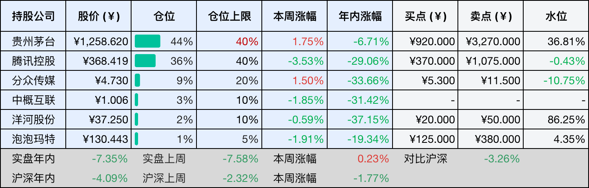
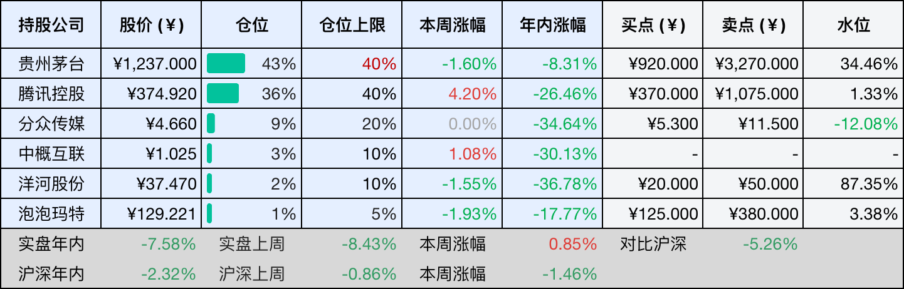
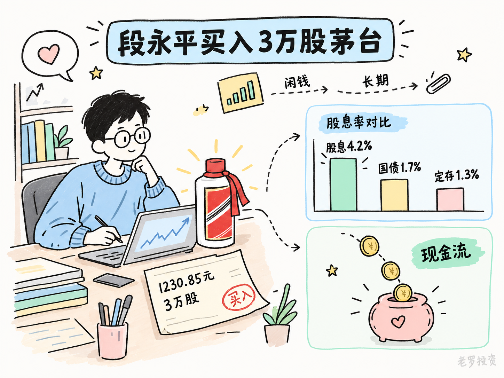
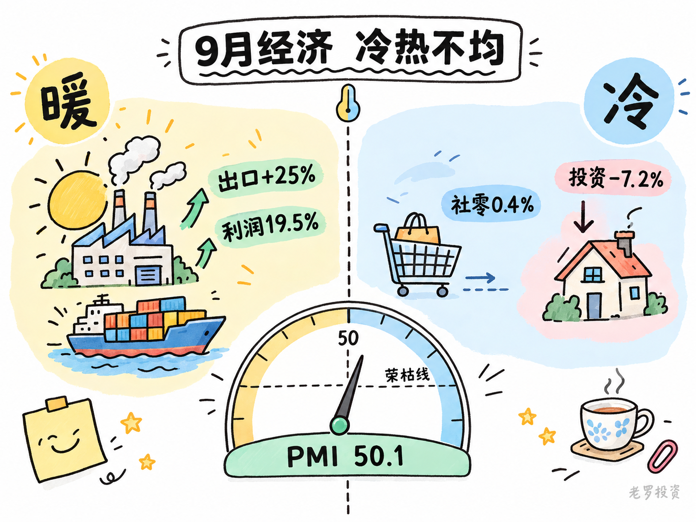

__微信公众号文章地址：[老罗投资周记-20261003](https://mp.weixin.qq.com/s/X4ZZhTBRORSyD2AJq-ky5w)__

```
老罗投资周记，每周六更新。专注于股权投资、阅读、学习与个人成长，知行合一、日拱一卒、投资人生。微信公众号【老罗投资】，文章均首发于公众号。
```

## 1. 本周交易

无

## 2. 目前持仓

当前持有的股票包括：贵州茅台 44%、腾讯控股 36%、分众传媒 9%、中概互联 3%、洋河股份 2%、泡泡玛特 1%。

此外还有部分现金，加上少量的恒瑞医药、海康威视、粉笔等股票，其份额较少，仅作为观察仓不进行记录。

本周投资组合整体涨跌 <span class="red">+0.23%</span>，年内收益率 <span class="green">-7.35%</span>。

1. 表格底部数据为老罗与沪深300指数年内收益率对比。
2. 港股持仓已按实时汇率换算为人民币。



## 3. 上周数据



## 4. 本周事项

+ 段永平买入3万股茅台
+ 9月份宏观经济数据

==只对持股和交易感兴趣的朋友，读到这里就可以退出了。后面是对上述事件的展开，无新内容。==

### 4.1 段永平买入3万股茅台

9月28日，段永平在雪球上发了条动态，说买了点茅台，配图显示成交价为1230.85元，一共3万股，花了大概3692万。这是他今年第三次公开加仓，前两次分别在4月和6月。买完之后也没多说什么，就一句买了点，像是顺手添了一笔。

1230元股价，对应茅台2025年每股约52块的分红，算下来股息率4.2%左右，现在五年期定存利率也就1.3%上下，十年期国债收益率不到1.7%，光看分红这一项，茅台已经比这些强不少。段永平买的可能不是短期价差，而是每年能稳定到账的现金流，他以前说过很多次，买股票就是买公司，买公司就是买它未来现金流的折现。

但茅台的增长故事已经和过去不一样了，2025年营收和净利润头一回双降，白酒行业还在调整。i茅台放量和连续提价能稳住价格体系，但商务需求恢复需要时间。今年上半年营收同比增1.3%，净利润微降1.95%，二季度单季利润环比回落比较明显，往后三五年，利润年均增长5%到8%可能是更现实的预期。

段永平过去加仓茅台，多在市场情绪比较冷的时候，2024年茅台跌破1400他买过，2025年继续加，他的逻辑一贯是买生意本身，不看短期波动。但买得便宜，不等于未来收益率会复制过去。

茅台从2014年到2021年股价涨了十几倍，那是估值提升和业绩增长同时发力的结果，当时市盈率不到10倍，后来一度冲到60倍以上，现在估值处于历史中低位，继续大幅拔估值的空间不大。

按当前约1.55万亿市值和2026年预测净利润850亿到900亿算，市盈率在17到18倍，这个估值谈不上贵，但也算不上极端便宜。如果未来利润年增5%，加上4%出头的股息率，长期年化回报大概在8%到10%，比存定期强很多，也比大多数银行理财高。但和茅台过去动辄20%以上的年化收益率比，预期得往下调，不是茅台变差了，是基数大了，行业进入成熟期，定价权还在，但增速不可能还抱有之前的预期。

段永平买的是自己看得懂的公司，用的是闲钱，不设短期目标，普通投资者可以参考他的逻辑，但不必照搬操作。茅台的现金流依然扎实，分红和回购也在按计划推进，至于最终能拿到多少回报，取决于你买入的价格和持有的耐心。在低利率环境里，稳定现金流资产的价值确实在慢慢上升。



### 4.2 9月份宏观经济数据

9月制造业PMI回到50.1%，比上个月高了一点，重新站上荣枯线，综合PMI产出指数也到了50.7%。

但拆开看，改善并不算全面。生产指数从50.4%升到51.7%，新订单指数却小幅降到50.5%，生产增长明显快于订单。大企业PMI维持在50.6%，中型和小型企业分别只有49.7%和48.9%。这轮制造业回暖，主要还是大企业带动，中小企业的压力并没有明显缓解。

外需仍然是一个重要支撑，前8个月出口增长17.6%，8月份出口同比增长25%。这里面有去年基数较低的原因，但AI数据中心硬件、IT零部件等出口增长也比较明显，说明海外科技行业的采购需求还在，出口暂时还能给制造业提供一些支撑。

相比之下，国内需求还是比较弱，1至8月固定资产投资同比下降7.2%，民间投资下降10.1%，房地产开发投资降幅接近20%，8月社零同比只增长0.4%。收入和就业预期偏弱，再加上去年促消费政策带来的高基数，消费短期内很难明显提速。

价格也没有出现明显的全面上涨，8月PPI同比涨幅扩大到3.8%，主要受油价和有色金属价格上涨带动；CPI同比上涨0.8%，核心CPI回到1.0%。工业品价格在涨，但居民消费的热度还没有明显起来。

企业利润倒是在继续改善，8月规上工业企业利润同比增长19.5%，1至8月累计增长15.7%，装备制造业和高技术制造业表现相对突出。

所以现在的情况是制造业在好转，出口还有韧性，企业利润也在改善，但国内消费和投资依然偏弱，中小企业和房地产的压力也没有消失。新的增长点在起来，但原来的压力还没有完全消化，这种冷热不均的情况可能还会持续一段时间。



## 5. 本周读书

### 5.1 《我减掉了五十斤！心理咨询师亲身实践的心理减肥法》

作者徐徐38岁时身高1米58、体重150斤，后来从40岁起越减越健康，50岁减到99斤。她真正想回答的不是怎么少吃两口，而是你为什么一直吃不停。书里提出习得性肥胖、黄昏焦虑这些概念，你吃进去的超过胃需要的量，填的不是胃，是心里的洞。

评分四星⭐️⭐️⭐️⭐️

## 6. 本周运动

本周运动六次，全部都是健走，下周继续。

如果觉得本文还不错，那就点个赞或者在看吧，祝大家国庆节假期愉快！

```
老罗投资周记，每周六更新。专注于股权投资、阅读、学习与个人成长，知行合一、日拱一卒、投资人生。微信公众号【老罗投资】，文章均首发于公众号。
免责声明：本公众号只作为本人的投资日志记录，本文中提及的个股都有腰斩或血本无归的风险，本人不做任何投资建议，投资请坚持独立思考。
```

__微信公众号文章地址：[老罗投资周记-20261003](https://mp.weixin.qq.com/s/X4ZZhTBRORSyD2AJq-ky5w)__