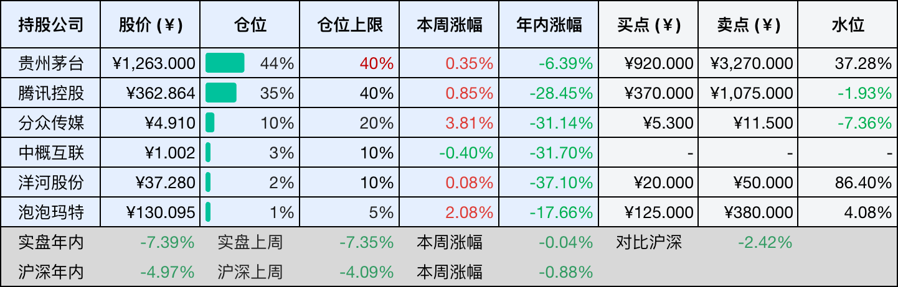
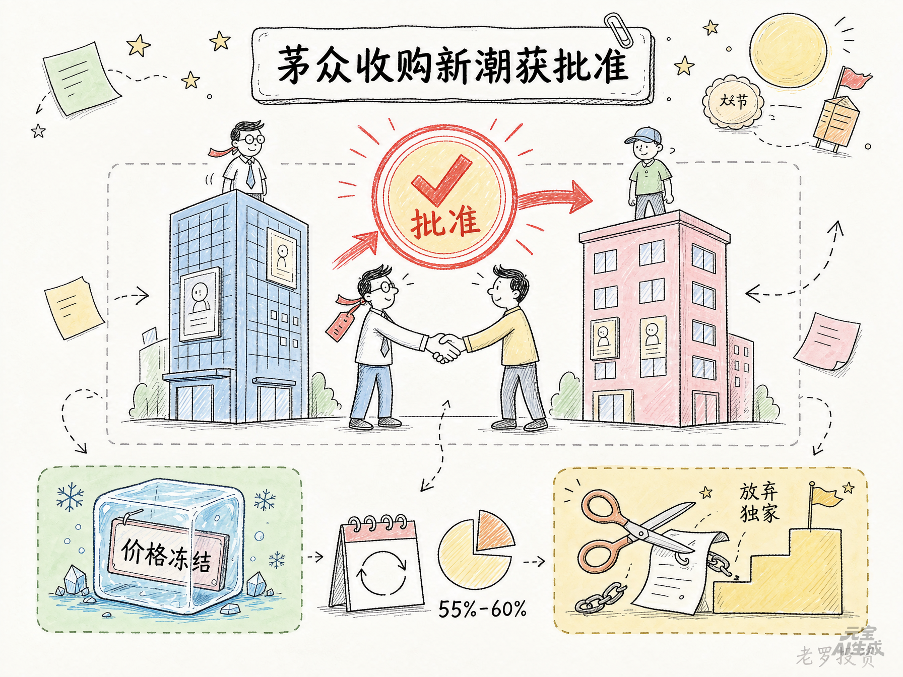
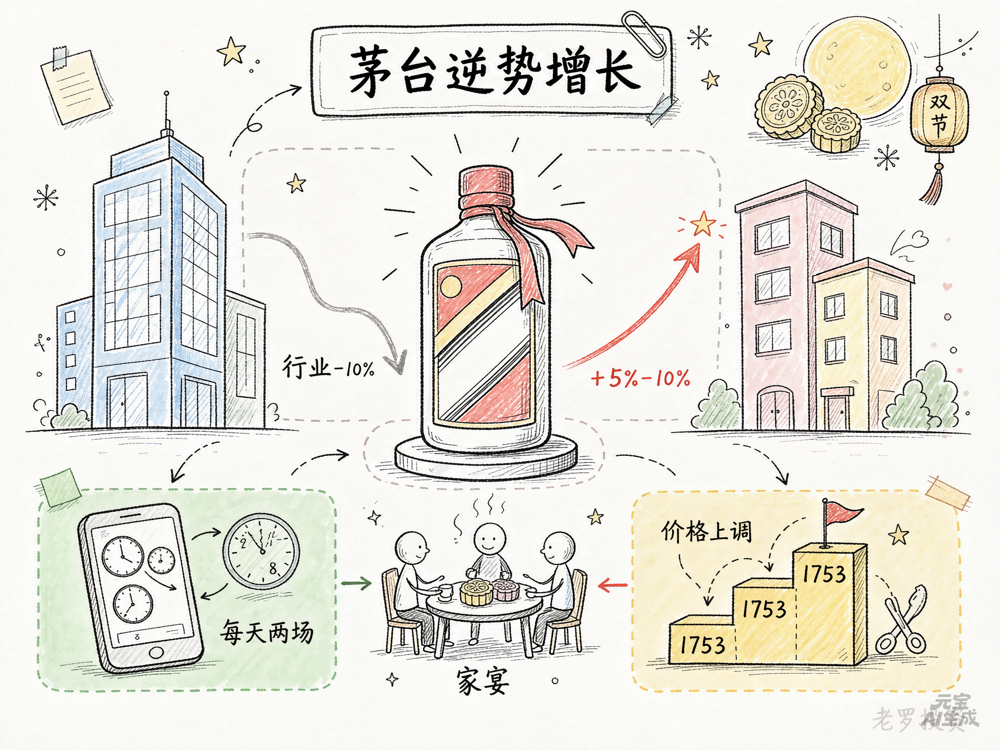

__微信公众号文章地址：[老罗投资周记-20261010](https://mp.weixin.qq.com/s/SH4nMWmPFSL8saIarJ-lgA)__

```
老罗投资周记，每周六更新。专注于股权投资、阅读、学习与个人成长，知行合一、日拱一卒、投资人生。微信公众号【老罗投资】，文章均首发于公众号。
```

## 1. 本周交易

无

## 2. 目前持仓

当前持有的股票包括：贵州茅台 44%、腾讯控股 35%、分众传媒 10%、中概互联 3%、洋河股份 2%、泡泡玛特 1%。

此外还有部分现金，加上少量的恒瑞医药、海康威视、粉笔等股票，其份额较少，仅作为观察仓不进行记录。

本周投资组合整体涨跌 <span class="green">-0.04%</span>，年内收益率 <span class="green">-7.39%</span>。

1. 表格底部数据为老罗与沪深300指数年内收益率对比。
2. 港股持仓已按实时汇率换算为人民币。



## 3. 上周数据


## 4. 本周事项

+ 分众收购新潮获批准
+ 中秋国庆双节茅台销售逆势增长

==只对持股和交易感兴趣的朋友，读到这里就可以退出了。后面是对上述事件的展开，无新内容。==

### 4.1 分众收购新潮获批准

分众收购新潮的事，今天终于有了结果，市场监管总局附条件批准了这笔交易，这是国内广告业第一起以附条件方式获批的经营者集中案件。

限制条件一共六项，核心是两条：一条是价格冻结，集中后实体各城市年度实际成交价，不得超过生效日前24个月内分众和新潮各自对应城市的实际成交价，没有正当理由不得涨价。另一条是放弃独家，分众须放弃已生效的独家条款相关权利，未来新签或续签点位也不得再达成独家条款和自动续约条款。这两条，一条管价格，一条管资源，对应的是监管对这笔交易最核心的两个担忧。

电梯媒体这个市场，分众加新潮，合计份额在55%到60%之间，监管眼中，这已经构成了推定的市场支配地位。过去几年分众的刊例价一直在涨，广告主并没有大量流失，说明这个渠道对品牌方来说有结构性依赖。合并之后如果没有约束，提价空间会更大，价格冻结相当于在合并完成那一刻，给分众的提价能力上了一道锁。

这对短期利润预期有直接影响，市场原本对这笔交易的期待之一，就是合并之后可以在部分城市提高广告定价，现在这条路被堵住了。至少五年内，分众不能靠涨价来增加收入，收购带来的份额提升，短期内没法直接变成定价权。

但价格冻结锁住的是涨价空间，不是利润改善的全部，合并真正的价值，可能不在收入端，而在成本端。

分众和新潮的点位网络有相当程度的重叠，分众以一二线写字楼为主，新潮聚焦社区，但两者在不少城市存在交叉。收购完成后，分众可以梳理重叠点位，砍掉重复的租金支出，削减冗余运维人员，把两套后台系统并成一套。

过去两家为了抢优质点位，在物业端不断抬价，推高了行业成本，合并之后这种内耗式竞争会消失。未来点位获取将更关注运营效率，租金的非理性竞争会得到抑制，成本协同的空间，可能比收入端的增量更明显。

独家条款放开，是另一个需要关注的地方。过去分众和新潮靠独家协议锁定优质点位，把对手挡在门外，享受到了资源垄断的红利，但也推高了物业端租金成本。现在独家协议被禁止，物业方可以在多家梯媒之间做选择。

短期看，这可能会增加分众维持点位的难度，特别是那些原本靠独家锁定的高端写字楼和社区。但换个角度，独家协议本身也是成本负担，放弃之后续签的谈判压力反而可能减轻。

监管在审查中还提到，互联网广告已经占广告发布总收入的85%以上，交通出行广告、传统户外大屏等品类，也会在定价和效果层面对电梯媒体形成竞争约束，这意味着电梯媒体虽然高度集中，广告主并非没有替代选择。

分众的定价权，始终受到整个广告大盘的制约，这也解释了为什么监管选择附条件批准，而不是直接否决。产业集中的效率提升被认可，但前提是不损害广告主利益。

2025年分众全年营收127.59亿元，同比增长4.05%，归母净利润因为计提数禾科技减值而大幅下滑，但经营性现金流净额72.09亿元。收购新潮的对价77.94亿元，现金部分只有2964万元，其余以股份支付，对现金消耗很小。新潮并表后，分众的媒体网络密度会进一步增加，新潮在200多个城市运营的70多万部智能屏，与分众现有的写字楼网络形成场景互补。

限制条件生效五年，期间分众不能涨价，不能签独家，这五年是消化整合、释放成本协同的窗口期。如果整合顺利，分众可以用更低的成本运营更大的网络，在价格不变的情况下提升利润率，这条路走通了，比直接涨价带来的回报更可持续。

但如果整合不及预期，重叠点位梳理不顺畅，成本协同释放不出来，这笔收购的价值就要打折扣，后续值得关注的，是合并完成后几个季度的成本变化和刊挂率数据。



### 4.2 中秋国庆双节茅台销售逆势增长

双节过完，白酒行业整体不算景气，白酒销售渠道反馈的动销数据，同比掉了大约一成。但飞天茅台是个例外，多地销量比去年同期涨了5%到10%，批价也一直稳在1720到1730之间，节后没什么回落。

i茅台的6款次新飞天，从8月起把原来每月9号、19号、29号的集中投放，改成了每天上午9点和晚上8点两场。以前买酒得盯着日子抢，现在机会分散了，买到的概率大了不少。

价格也在慢慢上调，9月初，茅台自营店挂牌价从1719调到1753，年初还是1499。官方价格上调，市场加价的空间变小了，以前黄牛收一瓶能加百来块，现在加十块都费劲。这说明茅台的定价体系在变化，但官方标价和实际成交价之间，差距不会在一夜之间抹平。

买酒的人也在发生变化，以前节前主要是企业和商务宴请，今年个人购买的明显多了，用途多是家宴、走亲访友和婚宴。商务需求没完全回来，家庭消费接上了一些，不过家庭消费和商务消费不是一回事，单次买得少，价格也更敏感，能不能持续，还得再看几个月。

不少白酒品牌的经销商还在消化库存，终端不太愿意接货，茅台这边库存压力小，回款正常，有的甚至提前打了10月的款。飞天茅台的量价和渠道利润整体还算健康，没太多积压的货，就不必急着降价出货，价格自然稳得住。

但双节卖得好，不代表后面就没压力，茅台官方价格已经比年初高了不少，消费者愿不愿意继续买，最终还是要看真实需求。商务消费恢复得慢，家庭消费能不能承接得住，还需要时间验证，但至少从这个双节看，茅台受到的冲击比不少同行小一些。



## 5. 本周读书

### 5.1 《地下王朝：古猫讲中国墓葬》

这本书从三万五千年前的墓葬一路讲到明清皇陵，时间跨度拉得很开。难得的是本书读起来不累，史前的洞穴墓、殷商的人殉、秦始皇陵、马王堆，一座座古墓，讲的不只是怎么埋葬死者，更是古人对死后世界的各种想象。

评分四星⭐️⭐️⭐️⭐️

### 5.2 《财女养成计划》

这本《财女养成计划》挺适合刚开始研究理财的人，作者杨小平是人大经济学硕士，书里没什么大道理，一上来就给主角算了一笔账：月薪五千，花呗欠两千四，每月结余三百，这种消费方式叫慢性财务自杀。作者给的应对方法也不复杂，三卡分流、二十四小时冷静期、把副业当公司开，理财新手可以试试书中的方法。

评分三星半⭐️⭐️⭐️✨

### 5.3 《书架上的博物馆：三星堆之谜》

作者周新华是考古科班出身，在浙江省博物馆做过学术部主任，写这本三星堆的小书算是降维打击。全书一共就两万多字，图文并茂，从1931年英国牧师在广汉农家偶然听到玉器闲谈起笔，把三星堆的发现、发掘、文物和古国消亡一路梳理了下来。

评分四星⭐️⭐️⭐️⭐️

## 6. 本周运动

本周运动四次，全部都是健走，下周继续。

如果觉得本文还不错，那就点个赞或者在看吧，祝大家周末愉快！

```
老罗投资周记，每周六更新。专注于股权投资、阅读、学习与个人成长，知行合一、日拱一卒、投资人生。微信公众号【老罗投资】，文章均首发于公众号。
免责声明：本公众号只作为本人的投资日志记录，本文中提及的个股都有腰斩或血本无归的风险，本人不做任何投资建议，投资请坚持独立思考。
```

__微信公众号文章地址：[老罗投资周记-20261010](https://mp.weixin.qq.com/s/SH4nMWmPFSL8saIarJ-lgA)__