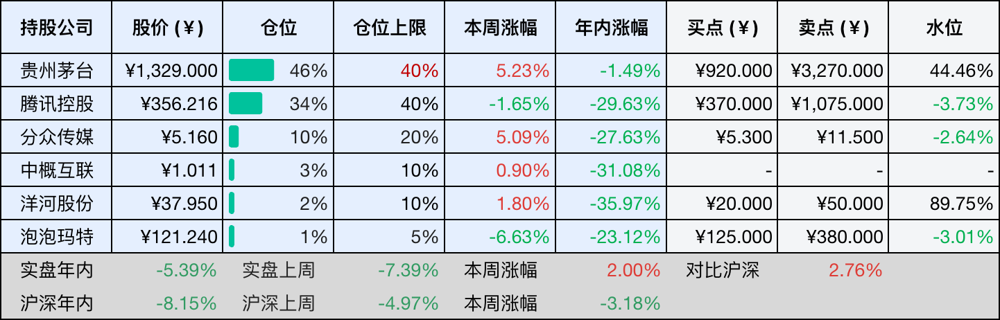
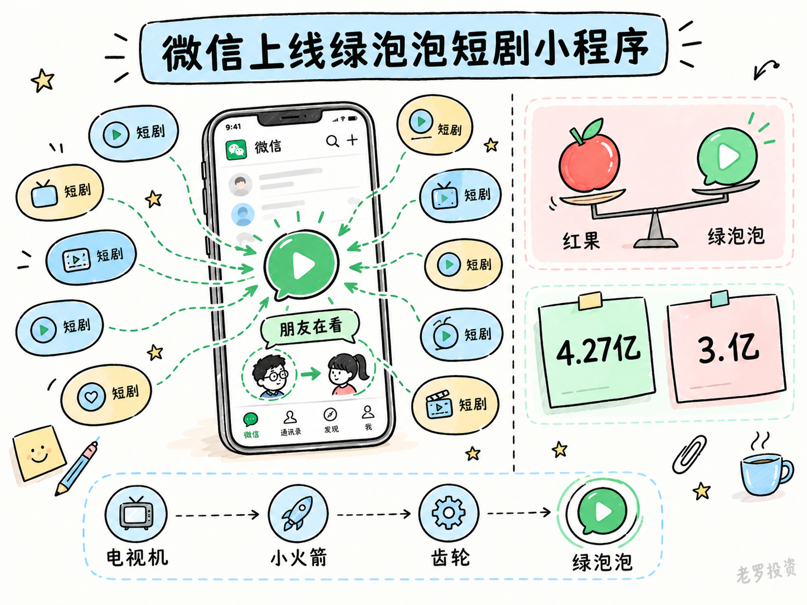
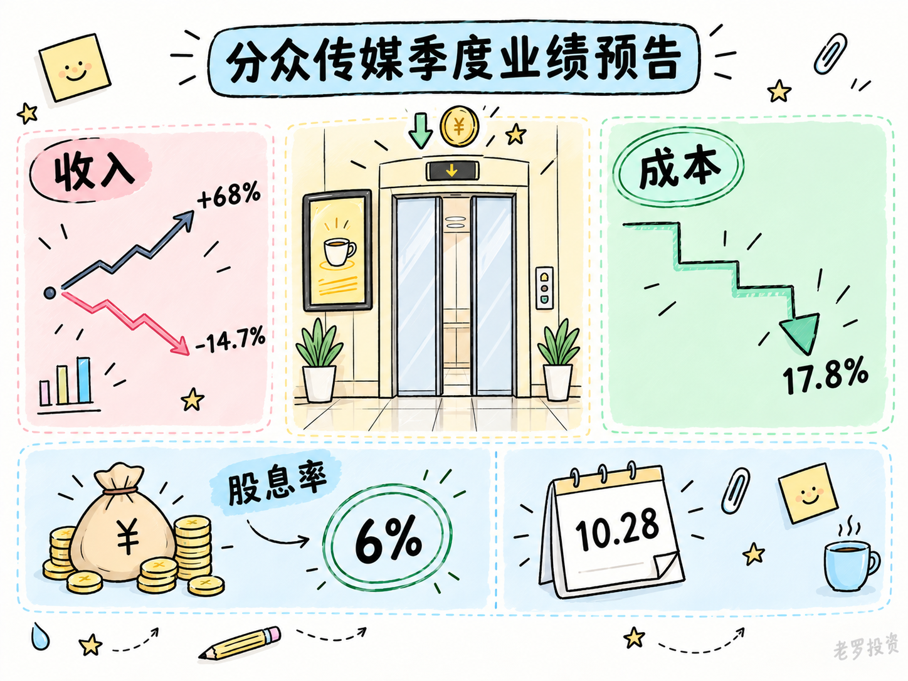

__微信公众号文章地址：[微信绿泡泡上线，收拢短剧流量；分众Q3前瞻，降本优于增收 | 投资周记20261017](https://mp.weixin.qq.com/s/lOleXVfd9dVGZTTlXUz5hQ)__

```
老罗投资周记，每周六更新。专注于股权投资、阅读、学习与个人成长，知行合一、日拱一卒、投资人生。微信公众号【老罗投资】，文章均首发于公众号。
```

## 1. 本周交易

无

## 2. 目前持仓

当前持有的股票包括：贵州茅台 46%、腾讯控股 34%、分众传媒 10%、中概互联 3%、洋河股份 2%、泡泡玛特 1%。

此外还有部分现金，加上少量的恒瑞医药、海康威视、粉笔等股票，其份额较少，仅作为观察仓不进行记录。

本周投资组合整体涨跌 <span class="red">+2.00%</span>，年内收益率 <span class="green">-5.39%</span>。

1. 表格底部数据为老罗与沪深300指数年内收益率对比。
2. 港股持仓已按实时汇率换算为人民币。



## 3. 上周数据


## 4. 本周事项

+ 微信上线绿泡泡短剧小程序
+ 分众传媒季度业绩预告

==只对持股和交易感兴趣的朋友，读到这里就可以退出了。后面是对上述事件的展开，无新内容。==

### 4.1 微信上线绿泡泡短剧小程序

微信最近上线了绿泡泡短剧小程序，这个产品短期跟红果不在一个量级上，但意义不在产品本身，而在于微信终于把散落在几十个小程序里的短剧流量，收拢到了一个官方入口。这是腾讯第四次做短剧，前三次都没做出来，这回总算是换了思路。

腾讯做短剧的时间线拉得挺长，最早是2021年腾讯视频十分剧场，说白了就是长视频App里的一个频道页。到2025年1月，火星短剧社在微信上线，后来改名火星观剧，算是腾讯第一款独立短剧产品。同年6月，微信又上线了一个叫短剧的官方小程序。到了今年10月，这款小程序已经找不到入口了，位置让给了绿泡泡。

前三次共同的问题在于，腾讯一直把短剧当成一个需要独立入口的内容品类来做。独立产品要自己买量，官方小程序要用户主动搜索，本质上都是在微信的社交关系之外另起炉灶。但微信最擅长的从来不是中心化分发，而是熟人之间的分享和推荐。用自己不擅长的方式去做一个竞争激烈的赛道，结果就是前三次都没能持续下去。

绿泡泡跟红果的形态不一样，红果是独立App，靠算法推荐和外部买量拉人。绿泡泡不做App，就嵌在微信里，分免费剧场、刷一刷、我的三块，剧全部免费，中间插广告。比较重要的是社交痕迹更重，首页有个朋友在看的推荐位，还有地区热门榜，你朋友看了什么，会直接影响推给你的内容。

截至今年2月，微信生态里的短剧小程序月活已经到了4.27亿，比所有独立短剧App加起来的3.35亿还多。但这4.27亿散在几十个小程序里，谁也没做大。绿泡泡要做的，就是把这些分散的流量收进一个官方入口。而红果日活已经到了1.68亿，比腾讯视频、爱奇艺、优酷、芒果TV四家加起来还多。



### 4.2 分众传媒季度业绩预告

分众传媒将于10月28日公布三季报，机构的一致预期是Q3收入32.98亿元，比Q2的30.76亿元环比有所改善。我觉得三季度的核心变量不在收入端，而在成本端，租金成本下降的趋势如果延续，利润会比收入更值得关注。

收入端，分众上半年的客户结构已经出现了明显的分化，日用消费品收入同比下降14.7%，互联网客户收入却增长了68%，占比从15.73%升到26.6%。互联网广告的增量主要来自头部电商的投放和AI相关广告，AI应用类客户成了新的需求来源。

但互联网广告的基数问题在三季度会比较突出，2025年京东外卖在6月后大规模增投，推高了去年Q3的基数，这意味着今年Q3互联网广告的同比增速大概率会放缓。真正能撑住收入的，要看日用消费品能不能从上半年的下滑里缓过来，从个人体感上来说，感觉会比较难。

成本端的变化比收入端更确定，上半年楼宇媒体营业成本17亿，同比减少了大约1.5亿，主要来自竞争格局改善和点位优化。新潮的收购虽然还没完成交割，但租金成本的改善已经先出现了，销售费用率连续两个季度同比下降，Q2降到17.8%，去年是19.2%。如果按这个趋势延续，即便Q3收入只是持平，利润端的表现也可能比市场预期的好。

分众上半年经营性净现金流44.53亿，账面现金类资产合计112.46亿，有息负债只有2.41亿。2023到2025年，分红金额分别是47.66亿、47.66亿和49.10亿，当前的股息率在6%以上，只要现金流不出现大的波动，分红的确定性比利润增速更值得参考。



## 5. 本周读书

### 5.1 《半小时讲透控糖的秘密》

精制碳水像汽油，烧得快也灭得快，优质碳水像木柴，烧得慢而稳。书里给的控糖技巧很简单，每餐按蔬菜、蛋白质、主食的顺序吃，就能改善血糖。

评分四星⭐️⭐️⭐️⭐️

## 6. 本周运动

本周感冒，暂停运动，下周痊愈后再恢复。

如果觉得本文还不错，那就点个赞或者在看吧，祝大家周末愉快！

```
老罗投资周记，每周六更新。专注于股权投资、阅读、学习与个人成长，知行合一、日拱一卒、投资人生。微信公众号【老罗投资】，文章均首发于公众号。
免责声明：本公众号只作为本人的投资日志记录，本文中提及的个股都有腰斩或血本无归的风险，本人不做任何投资建议，投资请坚持独立思考。
```

__微信公众号文章地址：[微信绿泡泡上线，收拢短剧流量；分众Q3前瞻，降本优于增收 | 投资周记20261017](https://mp.weixin.qq.com/s/lOleXVfd9dVGZTTlXUz5hQ)__