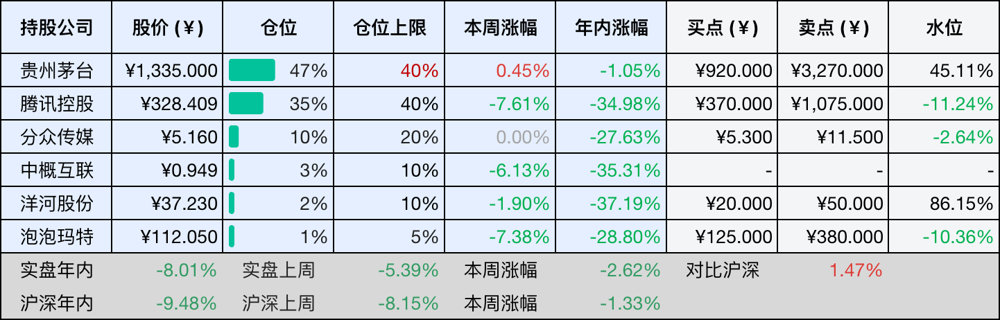
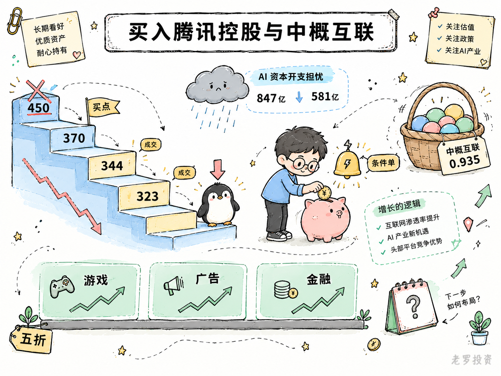
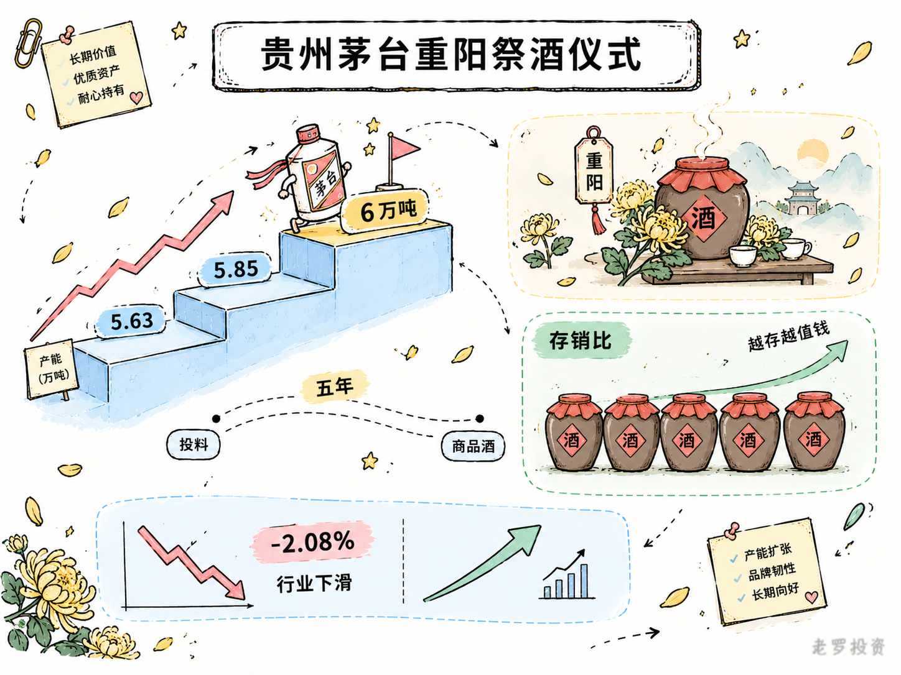

__微信公众号文章地址：[腾讯跌破买点自动加仓；茅台重阳祭酒，产能重新向上 | 投资周记20261024](https://mp.weixin.qq.com/s/pu6_YybikakalSTp-jybsA)__

```
老罗投资周记，每周六更新。专注于股权投资、阅读、学习与个人成长，知行合一、日拱一卒、投资人生。微信公众号【老罗投资】，文章均首发于公众号。
```

## 1. 本周交易

周三(10月21日)买入腾讯控股(00700)，买入价格为344.457元人民币。

周四(10月22日)买入腾讯控股(00700)，买入价格为323.663元人民币。

周四(10月22日)买入中概互联(513050)，买入价格为0.935元人民币。

## 2. 目前持仓

当前持有的股票包括：贵州茅台 47%、腾讯控股 35%、分众传媒 10%、中概互联 3%、洋河股份 2%、泡泡玛特 1%。

此外还有部分现金，加上少量的恒瑞医药、海康威视、粉笔等股票，其份额较少，仅作为观察仓不进行记录。

本周投资组合整体涨跌 <span class="green">-2.62%</span>，年内收益率 <span class="green">-8.01%</span>。

1. 表格底部数据为老罗与沪深300指数年内收益率对比。
2. 港股持仓已按实时汇率换算为人民币。



## 3. 上周数据


## 4. 本周事项

+ 买入腾讯控股与中概互联
+ 贵州茅台重阳祭酒仪式

==只对持股和交易感兴趣的朋友，读到这里就可以退出了。后面是对上述事件的展开，无新内容。==

### 4.1 买入腾讯控股与中概互联

周三和周四分别买了两笔腾讯，成交价344.457元和323.663元人民币，周四还用剩下的钱买了一点中概互联，成交价0.935元。腾讯这两笔是条件单自动触发的，之前设好的价格到了就成交，没怎么犹豫，中概互联是零钱顺手买的，仓位很小。

先说说为什么在这个位置买腾讯。最初基于当时的预期，设定的买点在450元人民币附近。但中报出来后，考虑到AI资本开支超预期，我下调了盈利预测，按2028年 Non-IFRS 净利润约2800亿元、25倍市盈率和五折安全边际，把买点降到了370元。

实际挂的条件单，我又在这个基础上多留了点安全边际。所以这次在323元和344元触发成交，不仅跌破了370元的买点，距离最初450元的锚点更是低了两成以上。

价格跌到这个位置，不是公司基本面出了什么新问题，而是市场对AI资本开支的担心在持续，上半年腾讯资本开支847亿元，二季度单季自由现金流首次转负，净现金从1468亿降到581亿，这些数字确实不好看。但游戏、广告、金融科技三大板块的收入增速还在，利润的根基并没有松动。市场在给AI投入定价，我认这个逻辑，但价格已经跌到了我认为足够便宜的位置。

中概互联的买入逻辑更简单，腾讯本身就在这个指数里占相当大的权重，买中概互联相当于在腾讯之外再配置一些其他的互联网公司，分散一下个股风险。0.935元的价格对应指数估值也在历史低位区间，仓位很小，属于顺手为之。

这两笔买入之后，腾讯的仓位略微有所提升，但还没有到上限，如果价格继续往下走，不排除再买一些。中概互联的仓位暂时不会加太多，它的波动比腾讯更大，而且指数里各家公司的基本面差异不小，需要更多时间去跟踪。



### 4.2 贵州茅台重阳祭酒仪式

10月18日，丙午年重阳祭酒仪式在茅台举行，董事长陈华和总经理王莉都出席了。我的看法是，仪式本身是例行公事，真正值得看的是产能节奏，今年茅台基酒有可能站上6万吨这个台阶。

2025年的实际产量是5.85万吨左右，2024年是5.63万吨，增量主要来自2024年10月和2025年9月陆续投产的两个制酒车间，各1800吨的设计产能，会在2026年的基酒里体现出来。6万吨不是官方口径，茅台在重阳活动上也没有披露具体投产数据，但产能的增长，今年大概率能站上6万吨台阶。

茅台基酒产量从2021年到2023年只上涨了一千吨出头，2024年还出现了近五年的首次减产，真正的增量是从2025年才重新开始的，目前投产的只是十四五技改项目的一小部分，大头还在后面。今年站上6万吨，是产能曲线重新向上之后的第一个明确节点。

白酒行业氛围却不太一样，2025年酱酒销售收入2350亿元，同比下降2.08%，是六年来的首次下滑。郎酒把新批次的基酒产量从6.05万吨调降到了5万吨，中小酒企减产停产已经持续了三年。

茅台选择在这个时候继续按自己的节奏投料，管理层的逻辑去年就讲过，行业低谷期多存基酒、提高存销比，等调整期过去再逐步投向市场，基酒越存越值钱，和一般制造业的库存不是一回事，白酒天然自带抗通胀属性。

看茅台的基酒产量，我通常不会只盯单一年份的数字，基酒从投料到变成商品酒至少需要五年，当年下沙多少，对应的是五年后的可售量。产量连续几年停滞，后面的供给弹性就会受限，产量重新爬坡，下一轮周期里可调配的空间就在变大。



## 5. 本周读书

### 5.1 《1小时看懂相对论》

这本《1小时看懂相对论》几乎不碰数学公式，用段子和手绘把相对论的来龙去脉捋了一遍，对零基础的人算友好，但1小时看懂只是个噱头，翻完仍然觉得似懂非懂。

当个轻松的开胃菜可以，指望它真让你弄懂时间膨胀和质能方程，大概率会失望。

评分三星半⭐️⭐️⭐️✨

## 6. 本周运动

本周运动三次，两次抗阻训练，一次健走，下周继续。

如果觉得本文还不错，那就点个赞或者在看吧，祝大家周末愉快！

```
老罗投资周记，每周六更新。专注于股权投资、阅读、学习与个人成长，知行合一、日拱一卒、投资人生。微信公众号【老罗投资】，文章均首发于公众号。
免责声明：本公众号只作为本人的投资日志记录，本文中提及的个股都有腰斩或血本无归的风险，本人不做任何投资建议，投资请坚持独立思考。
```

__微信公众号文章地址：[腾讯跌破买点自动加仓；茅台重阳祭酒，产能重新向上 | 投资周记20261024](https://mp.weixin.qq.com/s/pu6_YybikakalSTp-jybsA)__