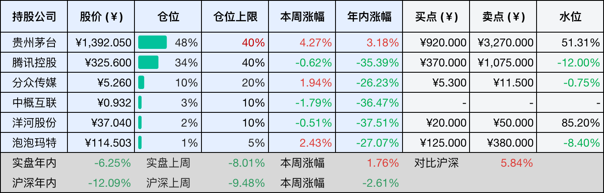
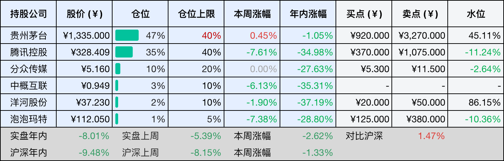
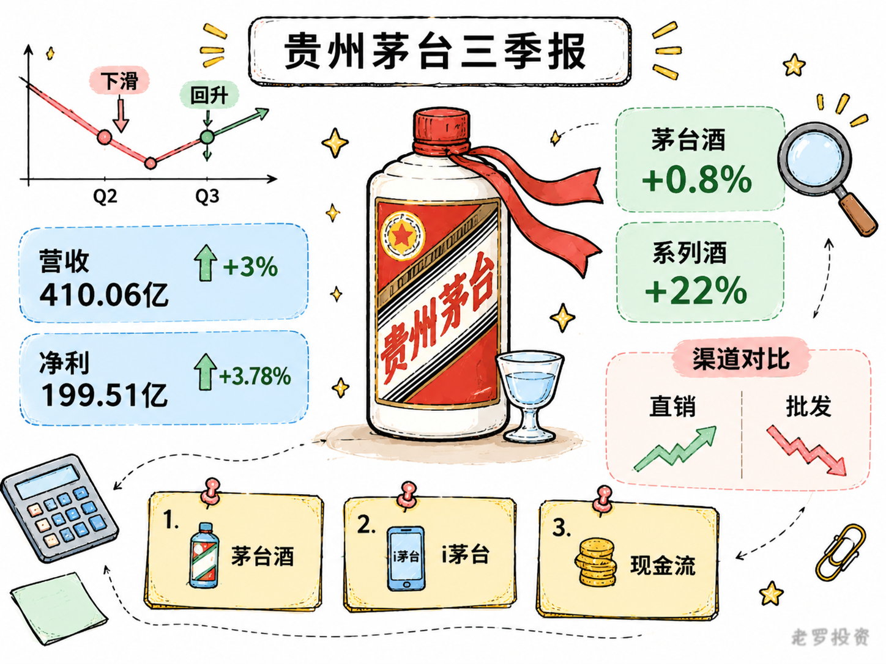
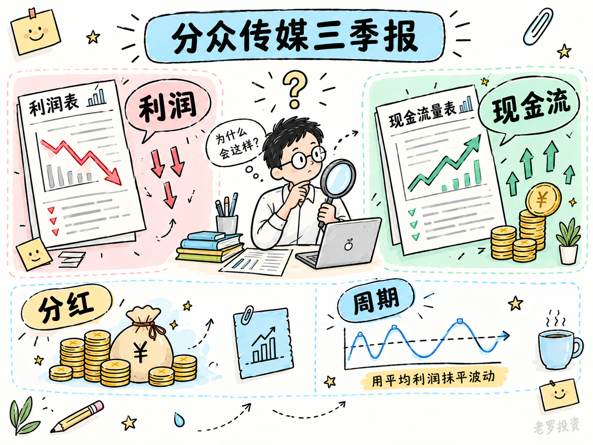
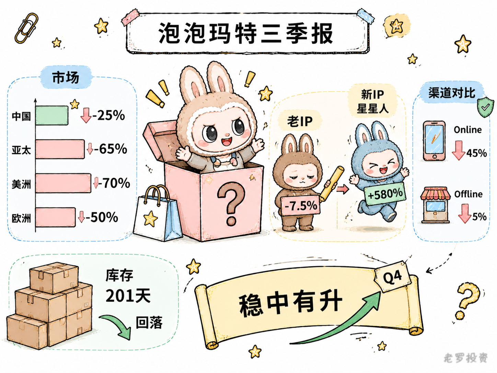

__微信公众号文章地址：[茅台单季营收艰难转正；分众现金流逆势增长，泡泡玛特海外遇冷 | 投资周记20261031](https://mp.weixin.qq.com/s/ow5R156iGtQDvNmCbcpvkg)__

```
老罗投资周记，每周六更新。专注于股权投资、阅读、学习与个人成长，知行合一、日拱一卒、投资人生。微信公众号【老罗投资】，文章均首发于公众号。
```

## 1. 本周交易

无

## 2. 目前持仓

当前持有的股票包括：贵州茅台 48%、腾讯控股 34%、分众传媒 10%、中概互联 3%、洋河股份 2%、泡泡玛特 1%。

此外还有部分现金，加上少量的恒瑞医药、海康威视、粉笔等股票，其份额较少，仅作为观察仓不进行记录。

本周投资组合整体涨跌 <span class="red">+1.76%</span>，年内收益率 <span class="green">-6.25%</span>。

1. 表格底部数据为老罗与沪深300指数年内收益率对比。
2. 港股持仓已按实时汇率换算为人民币。



## 3. 上周数据



## 4. 本周事项

+ 贵州茅台三季报
+ 分众传媒三季报
+ 泡泡玛特三季报

==只对持股和交易感兴趣的朋友，读到这里就可以退出了。后面是对上述事件的展开，无新内容。==

### 4.1 贵州茅台三季报

贵州茅台三季报出来了，第三季度实现营业总收入410.06亿元，同比增长3%；归母净利润199.51亿元，同比增长3.78%。相比二季度营收、净利润分别下滑约5%和7%的表现，这个季度确实有所好转。

单季重新回到正增长，至少说明业绩下行的势头有所缓和，但我不太倾向于把这份成绩单直接理解为经营拐点。对于茅台这样的公司，3%的增长并不算高，真正值得研究的是，这部分增长究竟从哪里来，以及核心产品的经营状态有没有改善。

前三季度累计营业总收入1332.84亿元，同比增长1.82%；归母净利润644.67亿元，同比下降0.25%。单季增长与累计数据之间的反差，说明上半年的压力仍然比较明显，Q3虽然把业绩拉回正增长，但距离恢复过去的增长节奏，还有一段距离。

第三季度，茅台酒实现营收352.01亿元，同比增长约0.8%；系列酒实现营收50.34亿元，同比增长22.13%。从绝对金额看，茅台酒依然贡献了绝大部分收入，但本季度的增长主要来自系列酒。

系列酒同比增长22%，看起来不错，不过这里有一个容易忽略的背景：去年同期系列酒收入只有41.22亿元，同比下降幅度较大。今年的增长有明显低基数因素，50.34亿元的收入规模也还没有恢复到2024年同期水平。因此，这个增速暂时还不能简单理解为系列酒需求全面复苏。

相比系列酒，我更在意茅台酒本身的表现，茅台酒是整个公司的基本盘，收入占比接近九成。第三季度正是传统的白酒消费旺季，又经历了产品价格调整，但茅台酒收入同比仅增长0.8%，这意味着价格变化尚未明显转化为收入增长。考虑到茅台酒的收入规模，哪怕增速只有几个百分点，对公司整体业绩的影响也远大于系列酒。

渠道结构的变化，则是这份财报另一个值得关注的地方。前三季度，茅台直销渠道实现营收737.74亿元，同比增长32.79%；批发代理渠道营收571.20亿元，同比下降21.58%。直销增长、批发代理下降，渠道重心继续向直营体系转移。

其中i茅台的变化尤其明显，前三季度，i茅台实现酒类不含税收入585.62亿元，占公司营业收入的比例已经相当高。单看第三季度，i茅台收入约183亿元，同比大幅增长，但去年同期基数很低，剔除i茅台之后，其他直营渠道的表现并不强。这说明，直营渠道的增长并不是所有渠道都在同步改善，而是相当程度上集中在i茅台这个平台。

我认为，这种变化需要从两个角度理解。一方面，茅台通过i茅台直接触达消费者，减少了传统经销链条中的部分环节，也能更直接地掌握消费数据。对于长期依赖经销商体系的茅台来说，直营渠道占比提升，有助于公司重新掌握产品销售和价格管理的主动权。另一方面，渠道模式变化不等于终端需求自动增长，过去经销商承担了相当一部分库存和资金压力，现在直营比例提高，公司需要面对的是消费者能否持续购买，以及产品能否在新的价格体系下保持稳定动销。

这也是为什么我会特别留意合同负债的变化，三季度末，茅台合同负债约20.84亿元，较年初有明显的下降。合同负债本质上，反映了经销商预付款等尚未确认收入的部分，下降既可能与销售模式、结算方式调整有关，也可能反映渠道打款意愿的变化，不能单独作为需求走弱的结论，但值得持续跟踪。

还有一个数据需要注意，前三季度经营活动产生的现金流量净额同比增长120.07%，这个数字看起来很亮眼，但公司在财报中解释，主要与财务公司同业存款到期收回，以及集团成员单位存款变化有关。因此，不能把这部分增长直接理解为白酒销售回款大幅改善。

从目前的情况看，茅台正在经历一次比较深刻的经营模式调整。过去依靠品牌稀缺性、经销商体系和持续扩张的高端白酒需求，能够维持相对稳定的增长；现在行业需求环境发生变化，公司需要在价格体系、渠道利益和消费者触达之间重新寻找平衡，这件事不会因为一个季度的业绩转正就结束。

对投资者来说，我觉得接下来有三个观察点。

首先是茅台酒本身的收入和销量，系列酒可以提供一定增量，但真正决定茅台长期竞争力的，还是飞天茅台等核心产品。如果后续茅台酒能够在价格体系趋于稳定后重新实现收入增长，业绩回暖才有更扎实的基础。

其次是i茅台的增长能否持续，以及增长能否真正转化为终端消费，直营比例提高是渠道改革的结果，但平台收入增长并不完全等同于消费者实际开瓶量。未来需要观察平台销售、批发渠道库存和市场价格之间能否形成更健康的关系。

最后是利润率和现金回款，前三季度营业成本增速明显高于收入增速，利润压力依然很大。合同负债、销售收现以及经营现金流需要结合起来看，不能只挑其中一个好看的数字。

从估值角度看，茅台已经不是过去那个可以轻松维持两位数增长的茅台，但它依然拥有很强的品牌壁垒、现金创造能力和股东回报能力。对于长期投资者而言，增长率下降并不意味着投资逻辑消失，关键是未来的盈利是否稳定，以及当前价格是否已经充分反映了这种变化。

我的理解是，三季报释放了一个积极信号：业绩下滑的势头有所缓和，但还不足以证明基本面已经全面反转。茅台接下来最重要的事情，不是把收入增速重新做得多高，而是在渠道重构和行业调整的过程中，让核心产品重新回到健康的供需状态。



### 4.2 分众传媒三季报

分众传媒三季报单季营收31.9亿元，同比下降8.6%，连续两个季度下滑，并且降幅还在扩大。归母净利润13.5亿元，同比下降了14.5%。剔除数禾科技那笔5.8亿元的一次性处置收益后，前三季度归母净利润约39亿元，同比下降8%，比上半年降得更多一些。

收入这边确实不太好过，即时零售去年的高基数只是一小部分原因，更主要的是消费类客户在缩减广告预算，互联网广告虽然涨得不错，但还是补不上这个缺口。

但这份财报里有一处和利润表方向相反的地方，前三季度经营活动现金净流入60.02亿元，同比增长了13%，净利润在降，经营现金流反而在增。分红用的钱来自经营现金流，跟账面净利润是两回事，按照分众当前的现金流水平，维持6.6%左右的股息率，压力还不算太大。

三季度单季营业成本同比上升3.3%，结束了2024年四季度以来连续七个季度的同比下降。营业成本上升，估计和影院媒体成本及设备折旧有关，设备更新换代的投入仍在进行中。毛利率因此同比降了3.36个百分点到70.74%，但仍然处在历史上比较高的位置。

分众是周期型企业，利润有起伏是这门生意的常态，对于这类公司，我通常不用单一年度的利润去算估值。席勒估值法用过去十年平均利润作为基数，把周期波动抹平，更贴合分众的资产属性。等年报披露后，十年均值会更新，那时候重新算一遍合理区间，比现在拿三季报的季度利润去推全年更有依据。

看周期型公司的财报，我一般会把利润表和现金流量表分开看，利润受会计确认和一次性损益影响，波动大；经营现金流反映的是真实回款，更能说明当下的经营质量。两者方向一致时，结论比较可靠；方向相反时，就需要多问一句为什么。

这次分众就是后者，利润在降，现金流在增，那么分红的可持续性就比单季利润的跌幅更值得关注。这个视角也可以用在其他周期型公司上，比如化工、资源类的企业，它们同样会出现利润和现金流不同步的阶段。



### 4.3 泡泡玛特三季报

泡泡玛特三季度业绩不太好看，整体收益同比下降45%至50%。其中，中国市场下降25%至30%，亚太下降65%至70%，美洲下降70%至75%，欧洲及其他地区下降50%至55%。

不过，这份季报真正值得关注的不是跌了多少，而是不同市场的表现差异，中国区虽然也在下滑，但明显好于海外。分渠道看，线上收益下降45%至50%，线下门店只下降5%至10%，同样面对去年三季度的高基数，线下显然更有韧性。这说明门店体验和多IP展示起了一定支撑作用，国内消费基本盘并没有随着LABUBU热度回落而同步走弱。

IP结构也能看出一些变化，上半年THE MONSTERS收入44.54亿元，同比下降7.5%，占比从34.7%降至26%；星星人收入26.5亿元，同比增长580.6%，占比从2.8%升至15.4%。老IP热度有所回落，新IP正在接棒，对泡泡玛特来说，这比单纯依赖LABUBU继续增长更有意义。IP消费有生命周期，真正决定公司长期价值的，是能否持续孵化新IP，让不同角色轮流接棒。

海外的情况要复杂一些，去年三季度LABUBU在海外集中爆发，基数很高，今年大幅回落有一定的高基数的原因，但海外业务也暴露出供应链和库存管理的问题。上半年末公司存货达到61.02亿元，存货周转天数升至201天，管理层表示库存从8月开始回落，但海外业务从快速扩张转向精细化运营，仍然需要时间。

管理层预计中国区四季度稳中有升，全年有望实现正增长，这个判断能否兑现，接下来还要看实际的经营数据。



## 5. 本周读书

### 5.1 《穷查理宝典：查理·芒格智慧箴言录》

这是我第二次读《穷查理宝典》，查理·芒格的价值，不只在于投资智慧，更在于他看待问题的方式：保持理性，跨学科学习，警惕人性的弱点，尽量避免愚蠢，而不是一味追求聪明。

很多道理初读觉得平常，重读才发现值得反复琢磨。扣掉的半星给微信读书的排版，那些方框里的内容可以直接跳过，阅读体验反而好了不少。

评分四星半⭐️⭐️⭐️⭐️✨

### 5.2 《量子其实超好懂》

这本量子科普书把量子叠加、量子纠缠这些听起来有些玄乎的概念讲得很直观。从量子的起源讲起，一路延伸到量子计算机和中国在这一领域的进展，中间还穿插了不少科学家的故事和科学史。全书没有堆砌公式，也没有为了让人看懂而把原理讲得过于简单，读起来比较轻松，又能学到实实在在的知识。

如果是给孩子选一本量子物理的入门书，这本挺合适，成年人也不妨翻一翻，尤其是那些学生时代一看到物理就头疼的人。很多曾经觉得遥远又难懂的概念，换个角度重新认识，或许就没那么难了。

评分四星⭐️⭐️⭐️⭐️

## 6. 本周运动

本周运动四次，两次健走，两次抗阻训练，下周继续。

如果觉得本文还不错，那就点个赞或者在看吧，祝大家周末愉快！

```
老罗投资周记，每周六更新。专注于股权投资、阅读、学习与个人成长，知行合一、日拱一卒、投资人生。微信公众号【老罗投资】，文章均首发于公众号。
免责声明：本公众号只作为本人的投资日志记录，本文中提及的个股都有腰斩或血本无归的风险，本人不做任何投资建议，投资请坚持独立思考。
```

__微信公众号文章地址：[茅台单季营收艰难转正；分众现金流逆势增长，泡泡玛特海外遇冷 | 投资周记20261031](https://mp.weixin.qq.com/s/ow5R156iGtQDvNmCbcpvkg)__