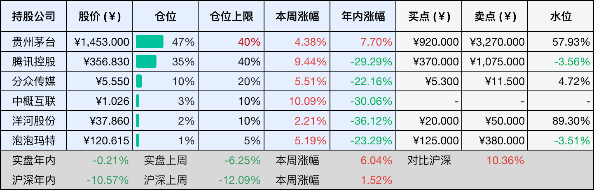
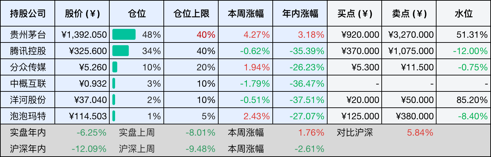

__微信公众号文章地址：[腾讯清仓B站正股，置换可转债留后手；混元Hy4发布，AI从陪聊走向实操 | 投资周记20261107](https://mp.weixin.qq.com/s/ow5R156iGtQDvNmCbcpvkg)__

```
老罗投资周记，每周六更新。专注于股权投资、阅读、学习与个人成长，知行合一、日拱一卒、投资人生。微信公众号【老罗投资】，文章均首发于公众号。
```

## 1. 本周交易

无

## 2. 目前持仓

当前持有的股票包括：贵州茅台 47%、腾讯控股 35%、分众传媒 10%、中概互联 3%、洋河股份 2%、泡泡玛特 1%。

此外还有部分现金，加上少量的恒瑞医药、海康威视、粉笔等股票，其份额较少，仅作为观察仓不进行记录。

本周投资组合整体涨跌 <span class="red">+6.04%</span>，年内收益率 <span class="green">-0.21%</span>。

1. 表格底部数据为老罗与沪深300指数年内收益率对比。
2. 港股持仓已按实时汇率换算为人民币。



## 3. 上周数据



## 4. 本周事项

+ 腾讯清仓B站？其实是把股票换成了可转债
+ 腾讯混元Hy4正式版发布

==只对持股和交易感兴趣的朋友，读到这里就可以退出了。后面是对上述事件的展开，无新内容。==

### 4.1 腾讯清仓B站？其实是把股票换成了可转债

腾讯把B站的直接持股从3.3%降到了接近零，但这次交易，我更关注的不是腾讯是否看空B站，而是它如何处理一笔持有多年的战略投资。与其直接在二级市场减持，不如通过回购换成可转债，既降低了退出过程中的市场冲击，也保留了未来重新获得股权的可能性。

公告显示，腾讯以2亿美元认购B站新发行的可转债，同时B站以2亿美元回购腾讯持有的Z类普通股，两笔交易金额相互抵销，没有实际现金往来。B站回购的1359万股将被注销，总股本从4.13亿股降到4亿股。可转债如果不转股，腾讯的直接持股比例归零，如果按照初始转股价全部转股，腾讯持股比例则会回到约2.3%。

从腾讯股东的角度看，这笔交易确实有几个值得琢磨的地方，腾讯原来持有的B站股票，属于权益类资产，股价波动直接影响投资价值，而且一旦集中出售，还可能面临流动性和市场价格的双重约束。现在换成可转债，资产属性发生了变化，腾讯不再需要直接承担这部分股票的日常价格波动，同时保留了未来转股的选择权。

当然，可转债并不意味着没有风险，它仍然取决于B站未来的偿债能力和经营表现。如果到期时股价低于转股价，腾讯可能更倾向于收回本金，如果B站持续增长，股价具备更大的上行空间，转股又能让腾讯分享后续收益。这相当于把原来单纯的股权投资，变成了一笔兼有债权属性和股权选择权的资产。

我觉得更值得关注的是腾讯自身的资本配置，对于腾讯这样的成熟互联网公司，投资一家外部企业，不能只看当初的战略协同，也要看持有期间的资金占用、风险和最终回报。过去几年，腾讯持续回购自身股票，也在调整部分非核心投资。相比长期持有一笔缺乏流动性的少数股权，适时改变资产形态，本身就是资本管理的一部分。

B站目前的盈利状况有所改善，2026年二季度净利润达到3.39亿元，同比增长55%，广告收入也首次超过游戏收入。B站盈利能力的改善，让这笔可转债有了更好的价值基础，但最终是否转股，腾讯仍然可以根据届时的股价和投资回报来决定。

我认为这次调整不必简单理解为看好或看空B站，更重要的是看腾讯如何在不同资产之间安排资金，以及每笔投资能否获得与风险相匹配的回报。投资一家公司的价值，不只体现在买入时的战略意义，也体现在什么时候调整、以什么方式退出，以及退出后资金还能创造多少价值。

### 4.2 腾讯混元Hy4正式版发布

腾讯混元Hy4正式版在11月4日发布，这次升级，我觉得值得关注的不是模型在测试榜单上提高了多少，而是腾讯开始让模型真正去做事情。对腾讯股东来说，比技术进步更重要的是，这些投入什么时候能够转化为收入，又能给现有业务带来多少价值。

Hy4这次加入了视觉理解能力，能够处理复杂图表、图像解析和图文推理。更值得留意的是Computer Use能力，AI不再只是告诉你怎么操作电脑，而是可以自己看屏幕、点鼠标、敲键盘，帮你完成一连串操作，甚至能使用CAD、Blender这类专业软件。相比过去一问一答的聊天模式，现在的模型开始尝试直接参与工作。

腾讯也在加快模型的落地，目前Hy4已经接入腾讯云TokenHub、WorkBuddy、CodeBuddy、元宝和企业微信智能助理大圆，API也向外部平台开放。腾讯的优势在于，手里本来就有微信、企业微信和腾讯云这些产品与客户资源，不需要从零寻找应用场景。

但产品接入不等于商业成功，企业愿不愿意付费，最终还是看能不能节省人工成本、提高工作效率。模型再先进，如果不能解决实际问题，也很难形成持续收入。

腾讯计划推出成本更低的Hy4 Flash，后续还计划开源模型权重，这有利于扩大用户和开发者规模，但也可能进一步压低模型服务的价格。未来真正有价值的，未必是模型本身，而是模型能否带动云服务、企业软件和其他业务增长。

从腾讯股东的角度，我更愿意把Hy4看作腾讯AI投入的一次阶段性进展，而不是新的利润增长点已经出现。接下来值得关注的，是AI相关收入能否增长，以及算力投入能否逐步转化为实际回报。技术进步只是起点，最终还是要看这门生意能不能赚钱。

## 5. 本周读书

### 5.1 《海瑞当官：大明王朝第一清官》

海瑞拖家带口赶着牛车去上任，面对的是不服管的下属、通倭的官员和一桩通天冤案。书里的海瑞不是只会抬棺材骂皇帝的愣头青，断案有谋略，做事懂迂回，刚直依然，但处事毫不呆板。

本书有一些虚构内容，适合当历史小说看，不要当作正史来读。

评分四星半⭐️⭐️⭐️⭐️✨

## 6. 本周运动

本周运动六次，两次健走，四次抗阻训练，下周继续。

如果觉得本文还不错，那就点个赞或者在看吧，祝大家周末愉快！

```
老罗投资周记，每周六更新。专注于股权投资、阅读、学习与个人成长，知行合一、日拱一卒、投资人生。微信公众号【老罗投资】，文章均首发于公众号。
免责声明：本公众号只作为本人的投资日志记录，本文中提及的个股都有腰斩或血本无归的风险，本人不做任何投资建议，投资请坚持独立思考。
```

__微信公众号文章地址：[腾讯清仓B站正股，置换可转债留后手；混元Hy4发布，AI从陪聊走向实操 | 投资周记20261107](https://mp.weixin.qq.com/s/ow5R156iGtQDvNmCbcpvkg)__