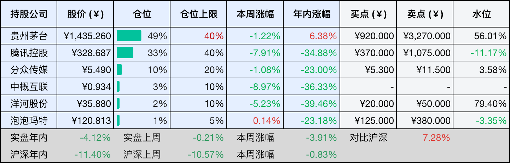
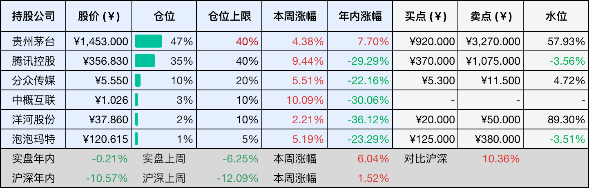

__微信公众号文章地址：[茅台否认买不到是稀缺，i茅台转向日常售卖；腾讯辟谣裁员50%，海陆分兵重配AI | 投资周记20261114](https://mp.weixin.qq.com/s/YAST08nHpbnVX8YzgC6A9g)__

```
老罗投资周记，每周六更新。专注于股权投资、阅读、学习与个人成长，知行合一、日拱一卒、投资人生。微信公众号【老罗投资】，文章均首发于公众号。
```

## 1. 本周交易

无

## 2. 目前持仓

当前持有的股票包括：贵州茅台 49%、腾讯控股 33%、分众传媒 10%、中概互联 3%、洋河股份 2%、泡泡玛特 1%。

此外还有部分现金，加上少量的恒瑞医药、海康威视、粉笔等股票，其份额较少，仅作为观察仓不进行记录。

本周投资组合整体涨跌 <span class="green">-3.91%</span>，年内收益率 <span class="green">-4.12%</span>。

1. 表格底部数据为老罗与沪深300指数年内收益率对比。
2. 港股持仓已按实时汇率换算为人民币。



## 3. 上周数据



## 4. 本周事项

+ i茅台将逐步从抢购转向日常售卖
+ 腾讯辟谣大规模裁员

==只对持股和交易感兴趣的朋友，读到这里就可以退出了。后面是对上述事件的展开，无新内容。==

### 4.1 i茅台将逐步从抢购转向日常售卖

茅台这次三季度业绩说明会上，管理层提到，过去市场把流通环节囤货、炒作造成的买不到，当成了茅台的稀缺性，这其实是一种误解。

这些年大家已经习惯了茅台不好买，之前1499元的酒到了市场上，价格往往高出不少。但酒是真的不够喝，还是有相当一部分被放在了经销商和流通环节手里，这是两回事，价格高，未必等于真实的需求旺盛。

从当前的安排来看，茅台正在改变销售方式，i茅台将逐步从抢购转向日常售卖，自营门店也将面向社会开放，说到底，就是让消费者更容易买到酒，减少中间环节的囤积和炒作。

这个调整短期可能会影响市场批价，也会让经销商面临一些压力，但如果酒一直在渠道里转手，却没有真正进入消费者手中，这样的繁荣也很难持续。

2027年度茅台酒下沙生产已经结束，公司经过评估后没有新增基酒产能，白酒行业还在调整，经销商需要消化库存。这个时候不急着扩大生产，给市场留出消化时间，未必是坏事。

公司正在制定年内中期分红方案，茅台一直是现金流比较好的企业，过去市场更多关注它能不能增长、能不能提价、产能还能不能扩大。随着白酒行业增速放缓，这些增长故事可能不像过去那么容易讲了，企业每年能赚多少钱，能留下多少现金，又愿意拿出多少回馈股东，就变得更加重要。

对于长期持有茅台的股东来说，分红不是一个可有可无的附加项，企业赚到的钱，如果长期留在账上却找不到更好的投资方向，不如拿出一部分与股东分享。

茅台这几年积累了很强的盈利能力和现金创造能力，如果未来收入增长没有过去那么快，但依然能够保持稳定的利润和现金流，同时维持较好的分红水平，这本身就是一种不错的经营状态。

### 4.2 腾讯辟谣大规模裁员

本周闹得沸沸扬扬，腾讯将要裁员50%的消息被官方辟谣了，11月12日，腾讯公关总监张军回应称，这一说法是纯纯的误会和谣言，事情的源头，是腾讯28周年内部会议上马化腾提到的50%陆军、50%海军，说的是人员和业务方向的调整，并不是裁掉一半员工。

马化腾在会上提到生死存亡的时刻，还谈到老同志要学会让路，这些话放在AI快速发展的背景下，并不难理解。腾讯过去的优势主要来自微信生态、游戏和广告等成熟业务，这些业务贡献了稳定的收入和现金流，但AI正在改变互联网行业的竞争方式，过去积累的优势，并不意味着未来还能一直保持领先。

一半做陆军、一半做海军，我的理解是，腾讯希望在守住现有业务的同时，给AI留出更多空间，成熟业务继续做深，AI新业务则需要更多人去尝试，这和前几年互联网公司因为业绩压力而裁员降本，还是有区别的。

当然，调整资源只是第一步，AI需要持续投入算力、人才和研发费用，短期内未必能看到相应的收入。腾讯真正要解决的问题，是如何把AI融入微信、游戏、广告等现有业务，同时找到新的商业化机会。

我觉得腾讯最大的优势不只是微信拥有多少用户，而是这些用户和业务能够持续产生现金流，为公司提供试错的空间。但现金流充足，不代表转型就一定成功，过去的成功经验，有时反而容易成为新的束缚。

对腾讯这样的公司，守住微信和游戏当然重要，但如果只守着过去的优势，迟早也会遇到新的天花板。AI这场竞争，最终比的不是谁投入得更多，而是谁能真正把技术变成产品，再把产品变成好的生意。

## 5. 本周读书

### 5.1 《肥皂》

读《肥皂》，最有意思的地方，就是看四铭这个道学先生如何露出马脚。街上遇见一个女乞丐，心里起了念头，回到家却开始大谈礼教，指责新学堂，感叹世风日下。

鲁迅写得很克制，一块肥皂、一家人的几句闲谈，就把四铭那点说不出口的心思揭了出来，嘴上越是道貌岸然，背后的东西反而越显得可笑。

评分四星⭐️⭐️⭐️⭐️

## 6. 本周运动

本周运动四次，两次健走，两次抗阻训练，下周继续。

如果觉得本文还不错，那就点个赞或者在看吧，祝大家周末愉快！

```
老罗投资周记，每周六更新。专注于股权投资、阅读、学习与个人成长，知行合一、日拱一卒、投资人生。微信公众号【老罗投资】，文章均首发于公众号。
免责声明：本公众号只作为本人的投资日志记录，本文中提及的个股都有腰斩或血本无归的风险，本人不做任何投资建议，投资请坚持独立思考。
```

__微信公众号文章地址：[茅台否认买不到是稀缺，i茅台转向日常售卖；腾讯辟谣裁员50%，海陆分兵重配AI | 投资周记20261114](https://mp.weixin.qq.com/s/YAST08nHpbnVX8YzgC6A9g)__