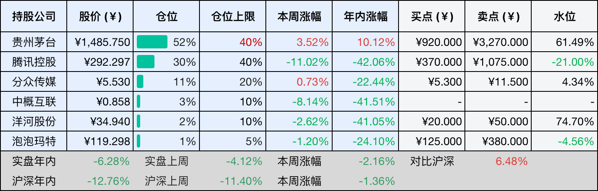
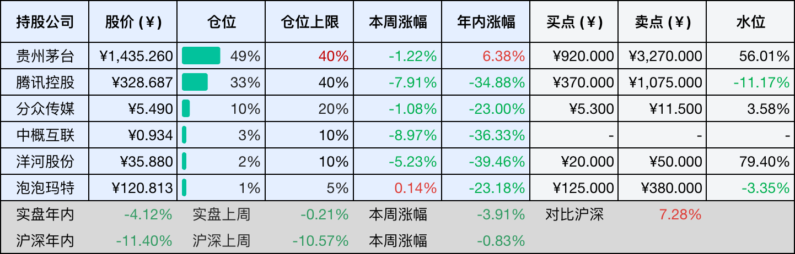
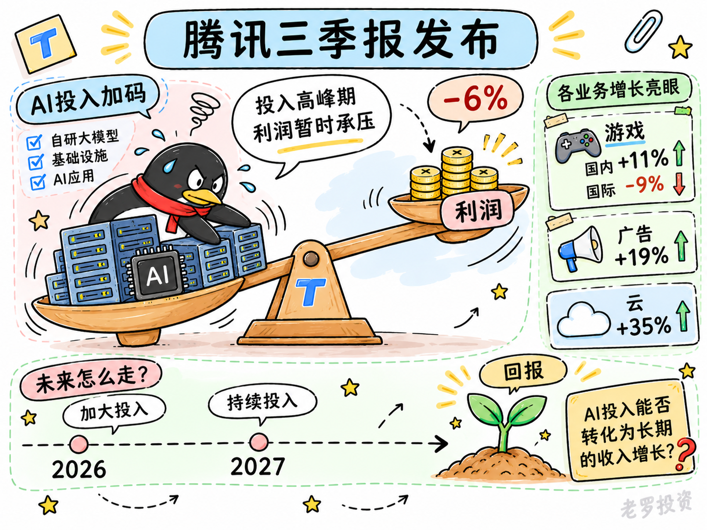
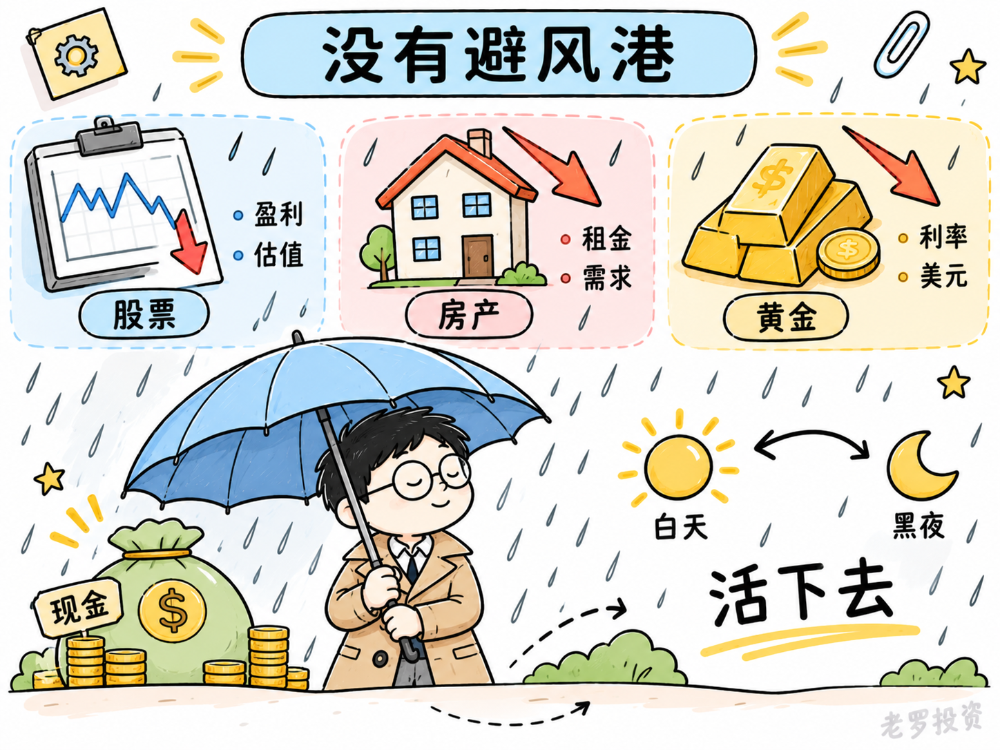

__微信公众号文章地址：[腾讯三季报发布，AI投入进入高峰期，利润暂时承压；没有避风港？这一周各类资产普跌 | 投资周记20261121](https://mp.weixin.qq.com/s/mv5j1xHTntDBCgIo2Omn3A)__

```
老罗投资周记，每周六更新。专注于股权投资、阅读、学习与个人成长，知行合一、日拱一卒、投资人生。微信公众号【老罗投资】，文章均首发于公众号。
```

## 1. 本周交易

无

## 2. 目前持仓

当前持有的股票包括：贵州茅台 49%、腾讯控股 33%、分众传媒 10%、中概互联 3%、洋河股份 2%、泡泡玛特 1%。

此外还有部分现金，加上少量的恒瑞医药、海康威视、粉笔等股票，其份额较少，仅作为观察仓不进行记录。

本周投资组合整体涨跌 <span class="green">-3.91%</span>，年内收益率 <span class="green">-4.12%</span>。

1. 表格底部数据为老罗与沪深300指数年内收益率对比。
2. 港股持仓已按实时汇率换算为人民币。



## 3. 上周数据



## 4. 本周事项

+ 腾讯三季报发布，AI投入进入高峰期，利润暂时承压
+ 没有避风港？这一周各类资产普跌

==只对持股和交易感兴趣的朋友，读到这里就可以退出了。后面是对上述事件的展开，无新内容。==

### 4.1 腾讯三季报发布，AI投入进入高峰期，利润暂时承压

腾讯三季报，有一个比较明显的变化，收入还在增长，原有业务也没有出现明显失速，但利润和现金流已经感受到了AI投入带来的压力。

第三季度，腾讯实现营业收入2073.36亿元，同比增长8%；归母净利润636.12亿元，同比增长0.8%。如果看非国际财务报告准则口径，归母净利润为665.19亿元，同比下降6%，非IFRS经营利润也下降了6%。收入增长，利润却在下降，说明腾讯当前面临的问题并不在于业务规模，而在于增长的成本正在上升。

但拆开业务来看，情况其实并没有想象中那么差。

增值服务收入983亿元，同比增长3%。其中，国内游戏收入476亿元，同比增长11%；国际游戏收入189亿元，同比下降9%。国内游戏依然表现不错，《三角洲行动》《无畏契约：源能行动》等产品带来了增长，国际游戏则受到去年同期高基数等因素影响。

游戏一直是腾讯最重要的利润来源之一，它的优势不仅是拥有大量用户，更在于产品生命周期、运营能力和发行体系。只要能够不断推出有竞争力的新产品，老游戏又能维持较长时间的收入贡献，这门生意就有很强的持续性。国内游戏目前没有太大问题，海外业务还需要继续观察。

广告业务是这份财报中更值得关注的亮点，第三季度营销服务收入430亿元，同比增长19%，明显快于腾讯整体收入增速。这背后还是微信生态的商业化能力，视频号、小程序、微信小店，以及短剧等内容形态，都在为广告业务提供新的场景。腾讯并不缺流量，真正重要的是如何把流量转化成商业价值，广告收入持续增长，说明微信生态仍然有进一步挖掘的空间。

不过，广告业务也并非没有代价，本季度营销服务毛利率从57%下降到52%，公司解释与AI相关运营成本以及短剧内容成本增加有关。收入增长很快，但新增收入并没有完全转化为毛利，后续还要看规模扩大后，盈利能力能否改善。

金融科技及企业服务收入637亿元，同比增长9%，其中云服务收入同比增长35%。AI相关服务需求增加，GPU租赁和模型服务业务增长，是云收入提升的重要原因。

过去市场更多把腾讯云看作腾讯生态的配套业务，现在AI算力需求正在给它带来新的增长机会。但云收入增长，并不意味着利润同步增长。算力采购、服务器折旧和能源成本都不低，最终还是要看收入增长能否转化为毛利和现金流。

如果说业务层面还有不少亮点，那么利润下降的原因，就要从费用端去找。第三季度腾讯一般及行政开支达到441亿元，同比增长29%，研发投入增加是主要原因，公司正在升级混元模型，推进微信AI能力建设，同时加大对元宝、WorkBuddy等AI产品的投入。

如果剔除研发开支，一般及行政开支同比只增长2%，这说明费用增加并不是各个业务部门都在失控，而是腾讯主动把更多资源投向了AI。剔除新AI产品影响后，非IFRS经营利润约833亿元，同比增长8%；包含这些新AI产品影响后，经营利润为680.73亿元，同比下降6%。两者相差约152亿元。这个数字可以看出，AI投入已经对腾讯当期利润产生了相当明显的影响。

管理层此前谈到过，腾讯这一轮AI投入主要集中在2026年至2027年，属于一个相对集中的投入周期，后续投入规模预计不会像这一阶段这么大，所以不能简单地把今年的高投入水平当成未来几年的常态。如果前期模型训练、算力基础设施和产品能力建设逐步完成，后续资本开支增速有所回落，那么对利润和自由现金流的压力也有机会减轻。

当然，投入规模下降不等于AI投入停止，模型迭代、推理服务和产品运营仍然需要持续投入。值得关注的是前期投入形成的能力能够逐渐进入微信、游戏、广告和企业服务，开始带来收入和效率上的回报。

对腾讯来说，AI并不是一项完全独立的新业务，它可以进入微信、游戏、广告、支付和企业服务等原有场景。假如AI能够提升广告转化率、改善游戏体验、提高办公效率，甚至带来新的企业服务收入，那么它创造的价值可能远远不止一项独立产品的收入。

但眼下，使用规模还不能直接等同于商业价值，用户使用AI产品的频率提高了，Token消耗量增加了，并不代表这些用户已经愿意付费，也不代表公司已经找到了足够好的盈利模式。这也是腾讯目前最需要证明的一件事，AI的投入最终能不能变成实实在在的利润。

然后是本季度现金流的变化，第三季度，腾讯经营活动现金流净额只有26亿元，而资本开支付款达到651亿元，加上媒体内容和租赁负债等现金支出，公司披露的自由现金流为负的691亿元。财报中解释，经营现金流中包含了大额算力采购预付款，如果剔除这部分预付款，自由现金流仍有169亿元。这个解释有一定的道理，也说明现金流转负并不完全是原有业务经营能力下降造成的。

不过，考虑到管理层此前给出的2026—2027年集中投入周期，当前的现金流压力也需要放在这个时间框架里观察，如果这轮投入确实在未来逐步放缓，那么市场现在担心的高资本开支、低自由现金流，未必会成为腾讯长期的财务状态。

从财务结构看，腾讯的净现金状况也发生了变化，第二季度末，公司仍有约582亿元净现金，到第三季度末则转为约137亿元净债务。虽然公司账面仍有大量现金和短期资金，但资本开支对现金流的影响已经开始体现。

这并不意味着腾讯出现了流动性问题，它的业务仍然能够产生现金，资产负债表也有较强的缓冲能力。只是过去腾讯最吸引投资者的一点，就是业务成熟、现金流充沛，能够持续回购和分红，现在AI投入提高了资金需求，这种变化需要持续跟踪。

第三季度腾讯继续回购股票，回购金额约70亿港元，长期看，持续回购并注销股份，对股东是有利的。不过，在AI资本开支明显增加的阶段，回购、分红和AI投入之间也需要重新平衡，相比回购金额本身，我更关心公司未来能否在维持必要AI投入的同时，能让自由现金流逐步恢复。

最后看估值，截至11月18日，腾讯股价约373港元，市盈率TTM约12.5倍，较过去一年的高点已经有较大回撤，从传统估值角度看，这个价格并不算贵。但现在给腾讯估值，不能只看过去的利润，原有业务仍然有不错的盈利能力，这是腾讯的基本盘；AI则可能带来新的增长空间，同时也增加了当前阶段的研发和算力成本。

这里需要考虑投入周期的影响。如果2026—2027年是集中建设期，那么用这一阶段被投入暂时压低的利润和现金流，直接判断腾讯长期盈利能力，可能会过于悲观。反过来，也不能因为未来投入有望下降，就提前把尚未兑现的AI回报全部计入估值。

我更愿意注意两个变化：一是2027年之后资本开支能否如管理层所说逐步回落；二是前期投入能否让云服务、广告和AI产品形成新的收入与利润来源。如果这两件事能够逐步兑现，腾讯现有的生态优势就有机会进一步放大。反过来，如果投入规模下降不及预期，商业化进展又比较缓慢，那么即使当前市盈率不高，也未必意味着估值已经足够便宜。

所以，这份三季报并没有改变我对腾讯长期竞争力的看法，微信生态、游戏业务和广告商业化能力，依然构成了很深的护城河。真正发生变化的是，腾讯正在经历一个相对集中的AI投入阶段，短期利润和现金流承受压力，但这笔投入也可能为未来几年的业务增长打下基础。这件事值得期待，但也需要时间来验证。

腾讯并不是缺少AI的机会，而是需要证明这轮投入最终能够成为股东真正拿到的利润，对长期投资者来说，公司的护城河仍然重要，投入周期也值得纳入判断，但买入价格和安全边际同样不能忽略。



### 4.2 没有避风港？这一周各类资产普跌

本周股票、房地产、黄金都在跌，连平时被当作避险资产的黄金也没能躲过。我的看法是，这轮普跌更像是市场在重新定价，而不是所有资产的长期价值都出了问题，短期价格可以一起下跌，但下跌的原因并不相同。

股票跌，可能是盈利预期变差，也可能是之前估值太高；房地产的压力更多来自需求、收入预期和流动性；黄金没有现金流，价格主要受实际利率、美元和避险需求影响。它们各有各的逻辑，只是在市场情绪转弱、资金需要降低风险的时候，容易一起被卖出。

不同资产的价格同时下跌，不代表它们的价值都在同步下降。股票要看企业能不能持续赚钱，房产要看租金和持有成本，黄金则更多承担货币信用和风险对冲的作用。

当然，也不能把长期投资当成不看价格的理由，买入时估值太高，企业盈利不及预期，房产租金覆盖不了持有成本，这些问题不会因为时间变长就自动消失，真正需要检查的，是当初买入的理由有没有发生变化。

市场下跌时，现金和负债的区别也会变得明显，手里有现金，至少还有等待和选择的余地；满仓又带着负债，可能连等待的机会都没有。长期投资不是比谁更能忍受亏损，而是买入时就考虑过可能出现的坏情况，确保自己有能力熬过周期。

查理·芒格说过一段话，我觉得放在现在很合适：我觉得痛苦是正常的。如果你做长期投资，无论是投资股票，还是投资房地产，我可以告诉你，一定既有哀鸿遍野的时候，也有蓬勃兴旺的时候。你要做的就是，无论是遇到了好时候，还是遇到了坏时候，都要安然无恙地活下去。正如吉卜林的诗中所说：“它们其实都是幻象。”有白天，也有黑夜，你有什么受不了的吗？没有。有时是黑夜，有时是白天。有时是繁荣，有时是衰退。我始终相信，应该尽到自己最大的努力，坚持到底。



## 5. 本周读书

### 5.1 《海昏疑云》

刘贺做了27天皇帝就被废了，海昏侯墓的出土，又让这段历史多了不少值得琢磨的地方。易中天围绕其中的种种疑点展开讲述，把刘贺短暂的帝王生涯和当时复杂的政治局势放在一起，读来颇有意思。

历史中有意思的地方，往往不在那些已有的结论里，而在那些看似不起眼、却经不起细想的细节中，需要读者多多留意。

评分四星⭐️⭐️⭐️⭐️

## 6. 本周运动

本周运动五次，全部是抗阻训练，下周继续。

如果觉得本文还不错，那就点个赞或者在看吧，祝大家周末愉快！

```
老罗投资周记，每周六更新。专注于股权投资、阅读、学习与个人成长，知行合一、日拱一卒、投资人生。微信公众号【老罗投资】，文章均首发于公众号。
免责声明：本公众号只作为本人的投资日志记录，本文中提及的个股都有腰斩或血本无归的风险，本人不做任何投资建议，投资请坚持独立思考。
```

__微信公众号文章地址：[腾讯三季报发布，AI投入进入高峰期，利润暂时承压；没有避风港？这一周各类资产普跌 | 投资周记20261121](https://mp.weixin.qq.com/s/mv5j1xHTntDBCgIo2Omn3A)__