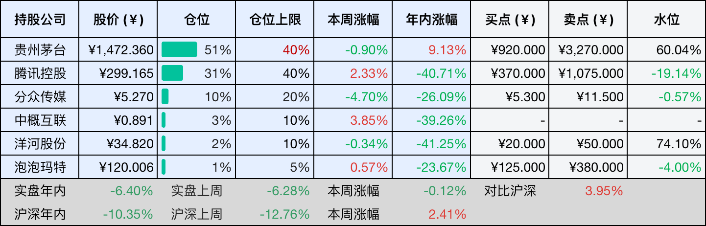
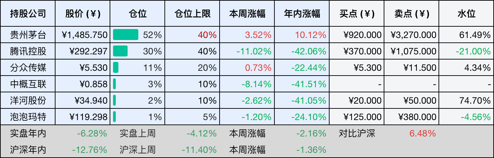
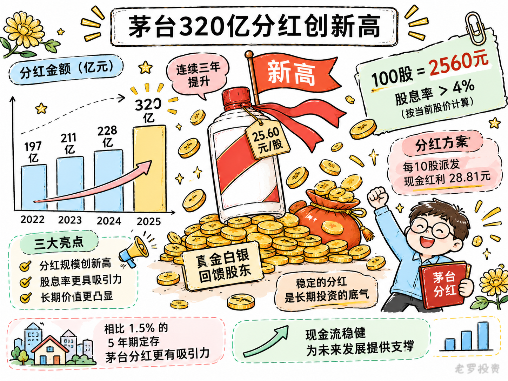
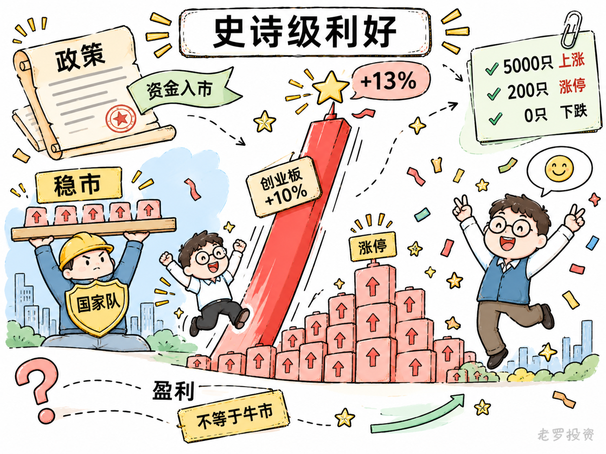

__微信公众号文章地址：[320亿元，贵州茅台2026年中期分红金额创新高；史诗级利好，5000只个股上涨 | 投资周记20261128](https://mp.weixin.qq.com/s/cDdincGPKKuxUAUnm7gJtg)__

```
老罗投资周记，每周六更新。专注于股权投资、阅读、学习与个人成长，知行合一、日拱一卒、投资人生。微信公众号【老罗投资】，文章均首发于公众号。
```

## 1. 本周交易

周二(11月24日)买入中概互联(513050)，买入价格为0.848元人民币。

周二(11月24日)清仓卖出粉笔(02469)，卖出价格为0.176港币(约0.150人民币)。

## 2. 目前持仓

当前持有的股票包括：贵州茅台 51%、腾讯控股 31%、分众传媒 10%、中概互联 3%、洋河股份 2%、泡泡玛特 1%。

此外还有部分现金，加上少量的恒瑞医药、海康威视等股票，其份额较少，仅作为观察仓不进行记录。

本周投资组合整体涨跌 <span class="green">-0.12%</span>，年内收益率 <span class="green">-6.40%</span>。

1. 表格底部数据为老罗与沪深300指数年内收益率对比。
2. 港股持仓已按实时汇率换算为人民币。



## 3. 上周数据



## 4. 本周事项

+ 320亿元，贵州茅台2026年中期分红金额创新高
+ 史诗级利好，5000只个股上涨

==只对持股和交易感兴趣的朋友，读到这里就可以退出了。后面是对上述事件的展开，无新内容。==

### 4.1 320亿元，贵州茅台2026年中期分红金额创新高

11月27日，贵州茅台公布2026年中期利润分配方案，拟向全体股东每股派发现金红利25.60元（含税），合计约320亿元，如果持有100股茅台，这次可以获得2560元现金分红（含税）。

这是茅台启动中期分红以来金额最高的一次，比2024年和2025年同期的300亿元增加了20亿元，在白酒行业仍处于调整期的背景下，茅台继续保持较高的分红水平，背后体现的还是公司较强的盈利能力和现金流实力。

茅台能够持续拿出大笔现金回馈股东，根本上还是因为公司有较强的赚钱能力。白酒行业有周期起伏，需求、库存和产品价格都会影响企业经营，但茅台凭借品牌优势和定价权，依然展现出了很强的盈利韧性和现金创造能力。

当然，分红创新高，不代表行业调整已经结束，接下来，产品动销能否恢复，渠道库存能否消化，才是更值得关注的事情。毕竟，分红反映的是企业当下的现金实力，未来能否持续，还要看经营能否跟上。

现金分红并不是额外创造出来的收益，除息后股价也会相应调整，对股东来说，真正重要的还是企业能否长期创造利润，并持续把一部分利润转化为现金回报。

相比320亿元这个数字，更需要关心的是茅台未来几年的盈利和现金流能否保持稳定，分红金额可以一年比一年高，但支撑分红的经营质量，才是一家企业长期投资价值的根本。



### 4.2 史诗级利好，5000只个股上涨

11月27日，国务院常务会议释放资本市场重磅政策信号，提出进一步完善资本市场稳市机制，加力发挥国家队稳市作用，优化中央汇金公司的类平准基金功能，同时推动上市公司加大分红回购力度，引导中长期资金入市。

政策消息落地后，A股午后迅速走强，迎来一轮久违的普涨行情，全市场超过5000只个股上涨，其中200多只个股涨停，无一只个股下跌。

这几项安排指向的都是市场长期关心的问题，包括市场波动时如何稳定流动性，上市公司如何提高股东回报，以及如何吸引更多长期资金入市，尤其是中央汇金类平准基金功能的优化，给市场释放了比较明确的政策信号。

市场迅速作出反应，科技成长板块成为领涨方向。科创50大涨近13%，创业板指涨约10%。盘面上，半导体、国产算力、光模块等板块集体走强，新易盛、中际旭创、寒武纪、中芯国际等算力硬件与芯片龙头均迎来大幅拉升。

这波上涨既有政策预期推动，也有前期调整后资金回补的因素，不过，单日5000只个股上涨，并不意味着新一轮牛市已经到来。政策改善的是市场预期，行情能否持续，最终还要看上市公司的盈利能力是否能够跟上。



## 5. 本周读书

### 5.1 《芒格之道——查理·芒格股东会讲话1987-2022》

二刷《芒格之道》，依然读得津津有味。35年的股东会讲话，既有投资中的得失，也有对人性、商业和人生的思考。好书常读常新，每次重读都有新的体会。

评分五星⭐️⭐️⭐️⭐️⭐️

### 5.2 《建筑也可以很好玩：欧洲篇，从古希腊到文艺复兴》

原本以为建筑史会是一本比较枯燥的专业读物，没想到这本书读起来颇有趣味，作者用漫画和历史故事，把古希腊、古罗马、中世纪一直到文艺复兴时期的建筑串联起来。

从柱式、拱券到宏伟的教堂，不仅讲建筑长什么样，也讲它们背后的文化、历史和时代变迁，读完再看那些欧洲建筑，会多一层理解。

评分四星⭐️⭐️⭐️⭐️

## 6. 本周运动

本周因为感冒只运动了两次，其中健走一次，抗阻训练一次，下周继续。

如果觉得本文还不错，那就点个赞或者在看吧，祝大家周末愉快！

```
老罗投资周记，每周六更新。专注于股权投资、阅读、学习与个人成长，知行合一、日拱一卒、投资人生。微信公众号【老罗投资】，文章均首发于公众号。
免责声明：本公众号只作为本人的投资日志记录，本文中提及的个股都有腰斩或血本无归的风险，本人不做任何投资建议，投资请坚持独立思考。
```

__微信公众号文章地址：[320亿元，贵州茅台2026年中期分红金额创新高；史诗级利好，5000只个股上涨 | 投资周记20261128](https://mp.weixin.qq.com/s/cDdincGPKKuxUAUnm7gJtg)__